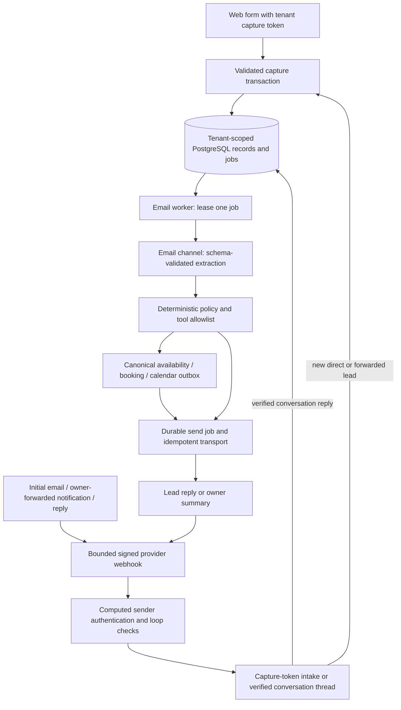

# LMC architecture

This describes the implemented email-first path and its trust boundaries. It is
not a production-readiness certificate. STATUS.md and TENANT_ISOLATION_AUDIT.md
record the unfinished product, ownership, API and security work.

## Runtime and packages

| Area | Responsibility |
| --- | --- |
| `apps/admin` | Next.js dashboard, authentication, operator APIs, public form/email boundaries, embed/widget and existing public REST/OAuth/MCP surfaces. |
| `apps/worker` | Email polling consumer, legacy BullMQ/outbox jobs, calendar synchronization and existing live voice attachment/controller integration. |
| `apps/landing` | Astro public pages and discovery/Markdown/schema endpoints plus Cloudflare Pages middleware. |
| `packages/domain` | Durable capture, inbound threading, suppression, qualification/booking decisions, human replies and follow-up rules. |
| `packages/db` | PostgreSQL/pgvector, schema/migrations, role clients, transaction context and RLS. |
| `packages/contracts` | Validated email envelopes, business settings, decisions, job payloads and channel/provider interfaces. |
| `packages/agent-core` | Email channel and structured model adapter; shared receptionist tools and original voice controller. |
| `packages/providers` | Explicit fake LMC providers, signed inbound adapters, email/calendar transports and legacy integrations. |
| `packages/jobs` | Existing Redis/BullMQ and presence infrastructure; the LMC email queue itself is PostgreSQL-backed. |
| `packages/shared` | Central brand identity and shared product/configuration definitions. |

## Email data path

Web forms can submit only their strict capture schema. Direct email uses
`lead+CAPTURE_TOKEN`; owner-forwarded notifications use `forward+CAPTURE_TOKEN` and
explicit contact/message fields. The outer forwarding sender must be the configured
owner. A capture capability grants neither CRM access nor booking verification.
The raw routing prefix is not authorization: its stored hash must match the tenant.

The production email webhook verifies exact signed bytes through its provider
adapter, obtains the received email through a fixed provider API origin, and uses
server-computed SPF/DKIM/DMARC verdicts. Authentication-Results and quoted routing
headers are untrusted. Body/envelope bounds, HTML-to-text conversion, history/
signature stripping, attachment ignoring, automatic-mail suppression and sender/
tenant quotas apply. Forwarded-notification parsing preserves only the necessary
quoted container; it does not infer recipients with an LLM. See EMAIL_INGESTION.md.

New direct/forward contacts default to no follow-up consent and no booking
verification. Outbound mail carries a separately generated hashed conversation
capability. A later reply must match sender, capability and a stored sent-message
reference before it verifies the requester. STOP has a deliberately narrow
suppression path, including authenticated direct intake STOP for that sender in
that tenant; unsubscribe GET only renders confirmation and POST changes consent.

## Persistence and effects

The seven native email tables are `lmc_settings`, `lmc_leads`, `lmc_messages`,
`lmc_events`, `lmc_suppressions`, `lmc_rate_windows` and `lmc_jobs`. They use non-null
tenant identity, RLS and tenant-bound relationships. Initial provider-event and RFC
Message-ID aliases are serialized and recorded atomically with contact/lead/message
and queued work. Duplicate/rekeyed delivery cannot create another reply; conflicts
do not overwrite prior messages. Conversation history and source metadata are durable.

Email workers discover due tenant IDs through the dispatcher role, then lease work
through the worker role with transaction-local business context. Only the executing
job is leased; waiting jobs do not expire behind a slow provider/model call.
Validated process/send/follow-up payloads and generation checks guard stale work.
Suppression/pause/consent/status are rechecked before effects. Provider idempotency
is required because a SQL commit and external delivery cannot be one transaction.
The current implementation stops uncertain retries at a conservative age and
requires owner reconciliation instead of silently duplicating a late delivery.

Qualification and scheduling reuse canonical contacts, staff/services, hours,
availability, appointment locks and calendar outbox synchronization. The model
extracts a strict decision; it cannot invent recipients, tools, services, prices
or slots. The worker selects configured text or actual offered slots, checks
requester verification, and falls back to a human for low confidence, complex
requests, complaints or injection. Emergency language selects pre-approved text
and alerts the owner without asking the model to write the emergency response.

Human replies preserve the thread and pause AI. Follow-ups require explicit
consent, have a maximum of three touches and tenant caps, include opt-out, and stop
on reply, opt-out or booking. Lead content remains untrusted throughout. Capabilities
are kept out of model inputs and CRM read responses, while private execution jobs
retain the minimum required routing capability.

## Database and HTTP authority

App, auth, worker, dispatcher, readonly/finance and internal System clients have
separate responsibilities. An app request gets its business/user context from
verified authentication and membership, not arbitrary asserted headers or model
output. Public REST keys are hashed, scoped and bound to their business. Internal
System operations use separately authenticated System authority; an app-set actor
GUC alone cannot create that authority. App/worker/dispatcher/System runtime logins
must not be superusers or BYPASSRLS. Migration/fixture authority is separate.

Migration 0073 gives 59 directly business-owned legacy relations stored generated
`tenant_id` aliases of canonical ownership; seven native email tables already have
tenant keys. Five mixed-scope relations and 17 global/user/OAuth/affiliate candidates
still need explicit ownership/association review. Generated keys and all-table CRUD
probes do not by themselves finish those requirements. See TENANT_IDENTITY.md.

The independent audit discovers live tables from pg_catalog, every Next route
handler, reachable worker HTTP routing, Astro endpoints and Pages middleware. It
requires real behavioral proofs instead of treating discovery/policies as coverage.
Current exhaustive HTTP coverage is incomplete; see its report and STATUS.md.

## Voice and operation boundaries

The original voice handler/controller and snapshot-based personalization remain.
The worker entry wraps live attach admission with canonical business/call/provider/
session/channel/conversation checks before session deduplication. The internal
service token remains necessary, and an authenticated inconsistent claim is denied.
See VOICE_ADMISSION.md; this is not an anonymous endpoint bypass claim.

The worker has existing liveness/readiness routes and explicit maintenance startup
behavior. Complete requested `/healthz`/`/readyz`, startup/headers/CI/dependency and
deployment hardening still need the remaining release work. LMC email fake bindings
and the offline demo are implemented; legacy dev voice/SMS/provider defaults are
not yet universally certified. Real DNS, sender/receiving domain setup, credentials
and operations are separate manual deployment prerequisites.

`pnpm lmc:demo` exercises the complete email workflow through temporary loopback
HTTP and PostgreSQL with fake external providers/clock, then removes its fixture
and emits a redacted report. It does not launch a persistent Next dashboard or
substitute for exhaustive production API isolation. See OFFLINE_DEMO.md.
